# WaveVGM
## A unified library for video game music
### Video Demo:  https://youtube.com/watch?v=

#### Introduction
I started this final project thinking I knew what to do, as I had many projects that I had wanted to tackle in the past. However, when I decided to start looking at those projects that I wanted to do, I realized that basically all of them required building off of somebody else's work. For this project, I wanted something I could claim as fully my own work. This stumped me for a while, thinking for so long of what I should do, and then it hit me. I always struggle with finding video game music to add to my playlists on normal streaming platforms. YouTube Music is the only place where you can actually find a decent amount of songs from video games as they were played in the games. But even that was difficult, with waves of copyright strikes forcing me to re-add every single song to my playlists, which eventually became so taxing that it wasn't worth rebuilding my library anymore. So why not create one, unified library for video game music that will never be shut down, and will always put a curated, expansive, and video game-focused library first? That was where WaveVGM was born.  

#### Features and code stack
Wave VGM is complete with:
- Personalized recommendations
- Full-text search (SQLite FTS5)
- Album and song browsing
- Persistent media player
- User accounts
- Likes and listening analytics
- Custom playlists
- Browse by console  

and is made with:
- Python
- HTML
- CSS
- JavaScript
- JQuery
- Flask
- Flask-Login
- Bootstrap
- Jinja2
- SQLite3
- Hotwire Turbo
- Splide
- Fitty
- and more

#### How to use the website
When you first open WaveVGM, you will see a homepage similar to this.  
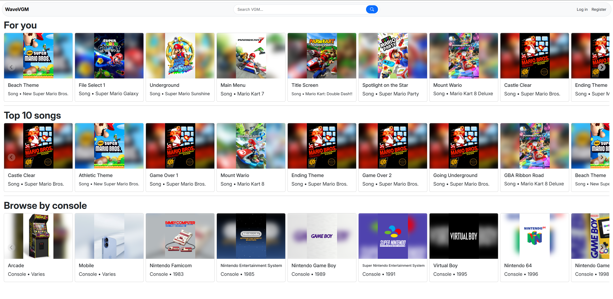  
The For You tab will suggest songs to your specific tastes when logged in, and will show the most liked songs when logged out. The homepage also includes a list of the top 10 songs by views, and a way to browse all games by the console they were released in. You can also see the search bar, where you can search for songs and albums using an FTS5 search algorithm. This search algorithm allows users to be able to find songs with a similar search engine to Google, with it automatically promoting the best match for the user's query.  

#### Registering
To register for WaveVGM, just press the register button at the top right of the screen. This will bring you to this screen.  
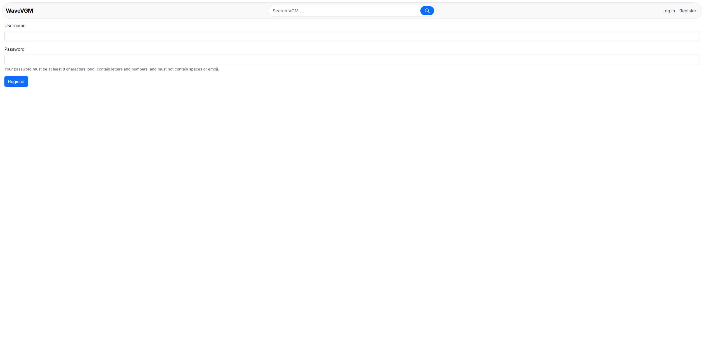  
Just choose a username and password, and select Register. You will be informed if the username already exists, or if the password does not fit the criteria. Once you register, you will be logged in and can start browsing with personalization!  

#### Logging in
Logging back into WaveVGM is very simple. Just tap the log in button at the top right of the screen, enter your details, and you're in!  
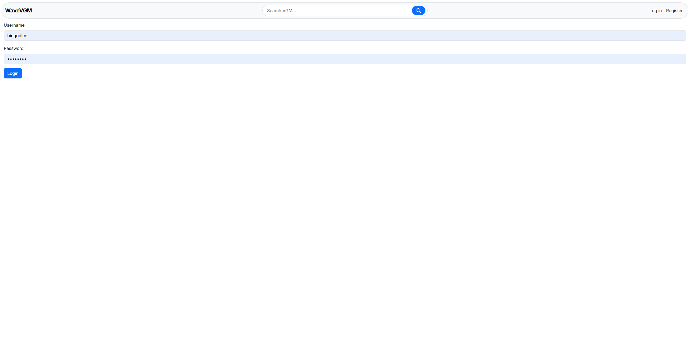  

#### Playing a song
Playing a song is very simple. Select the console that your game was released in, or search it up, and select the album card.  
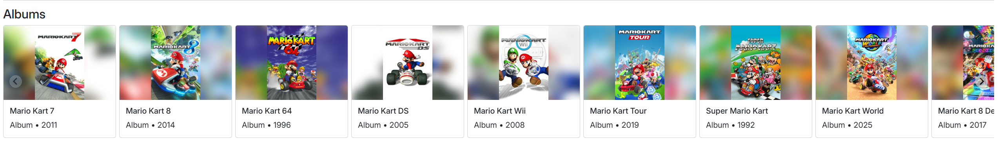  
From the album page, just select the song you would like to play, and it instantly starts up!  
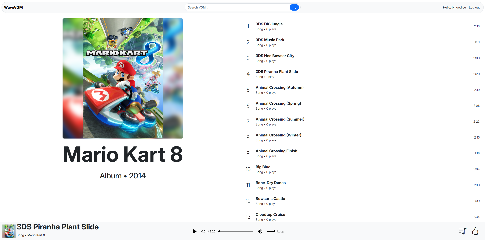    
Additionally, you can also play a song from the homepage or search by just clicking on the card.  
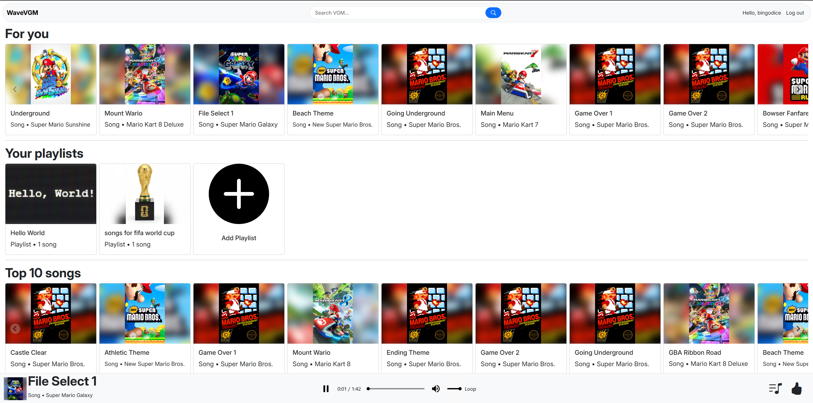  
No matter where you navigate, the song will continue to play, thanks to Hotwire Turbo's ```data-turbo-permanent``` HTML tag!  

#### Searching a song or album
In order to search a song or an album, just type your keyword in the top box on screen, and all the most relevant results will show up!  
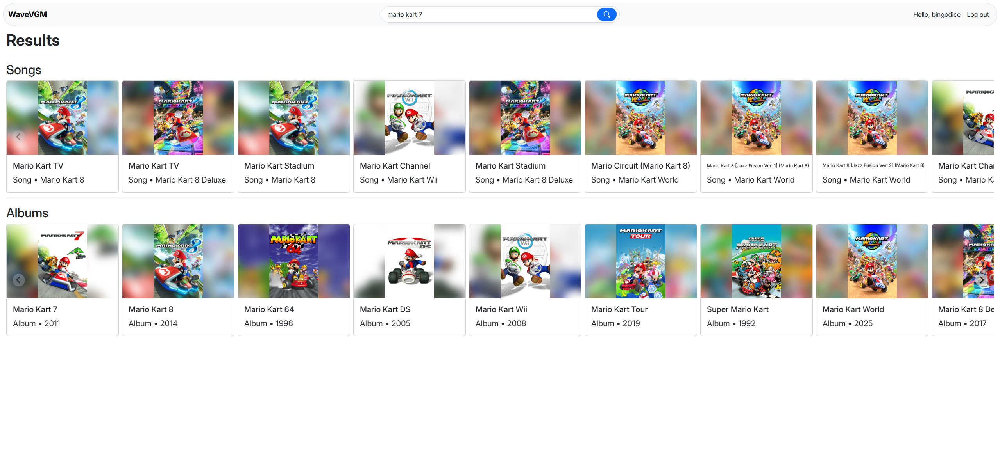  

#### Liking a song
Additionally, you can like a song by clicking the thumbs up button on the right side of the media player. This will signify to the algorithm that you enjoy the song, so it will recommend similar songs.  

### Playlists
#### Making a playlist
In order to make a playlist, select the "Add playlist" button in the home screen. Make sure you are logged in to see this button. After you select that button, you will see a screen similar to this one.  
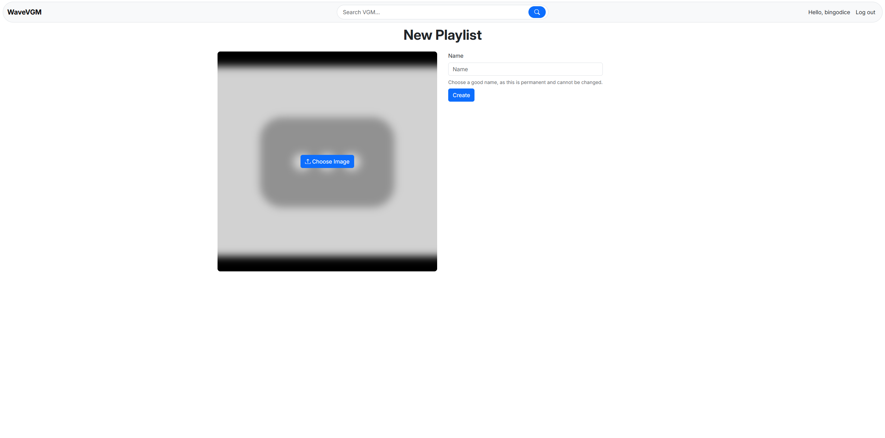  
Select "Choose Image" to choose a thumbnail image for your playlist, and paste in the link of your image. Then, make a good title for your playlist, and select "Create" to create the playlist.  
#### Adding songs to a playlist
In order to add songs to a playlist, just select the "Add to playlist" icon in the media player while the song you want to add to a playlist is playing. After that, select the playlist you want to add it to. You will be redirected to the playlist page where you will see that the new song has been added.  
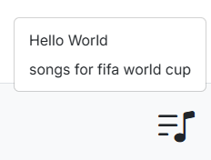  

#### Deleting songs from a playlist
In order to delete songs from a playlist, just select the trash can icon in the playlist page, then select the trash can on the song you would like to delete. That song will be deleted instantly.  
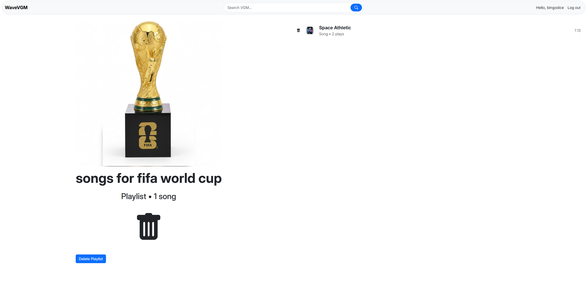  
#### Deleting a playlist
In order to delete a playlist, just select the trash can icon on the playlist's page and select "Delete playlist". You will be redirected to the homepage, where you can see that the playlist has been deleted.  
  

### Lite mode
In order to fit within GitHub's upload limits, I have uploaded a lite version of the database, which only has 2 playlists in it. In order to get the full experience, you can populate the MP3s manually yourself.  
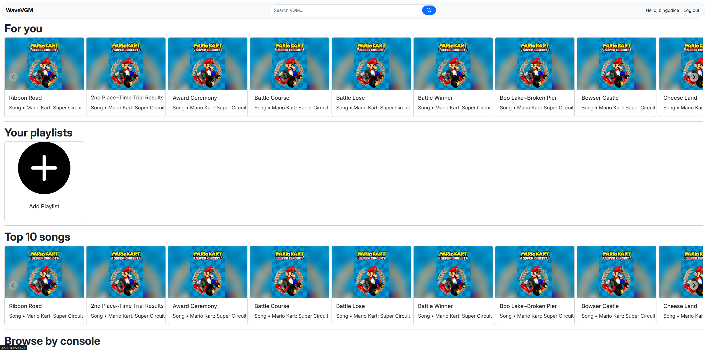


## Files

### ```/app.py```
This contains the main logic for the application. This has all the database queries, the login stuff, and each route for the pages.  

### ```/templates/layout.html```
This contains the layout that all HTML files extend from. It contains the navbar, the main content area, and the media player.

### ```/templates/index.html```
This contains the home screen, with the for you, the browse by console, and the playlists and top 10 area.

### ```/templates/search.html```
This contains the search screen for the site.


### ```/templates/album.html```
This contains the album screen for the site.

### ```/templates/macros.html```
This contains Jinja macros for the album, playlist and song cards. I chose this design as it makes it way easier to just pop in any page with these cards, as they are the heart of my website.

All other templates HTML files just do what the file name says.

### ```/static/functions.js```
This contains all JS functions, such as playing a song, sending analytics, or updating the dropdown menu on the add playlists screen to disable all playlists that have the song already on it.

### ```/static/styles.css```
This contains all the custom CSS for the project, such as the tight blur wrapper (built by gemini) or the media controls settings (fixed by gemini)

### ```/wavevgm.db```
This contains all data for the full version of WaveVGM, such as song and game titles, user data/playlists, and analytics for each song and user.

### ```/wavevgm_lite.db```
This contains all data for the lite version of WaveVGM, making sure that nonexistent songs do not populate the lite version.

All files in ```/static/consoles``` or ```/static/songs``` are for the database and referenced extensively, containing thumbnails and mp3s. ```/static/readme``` contains all images in this file. all other files are not that important, such as the CC-0 license (```/LICENSE```) or the Flask requirements file (```/requirements.txt```)